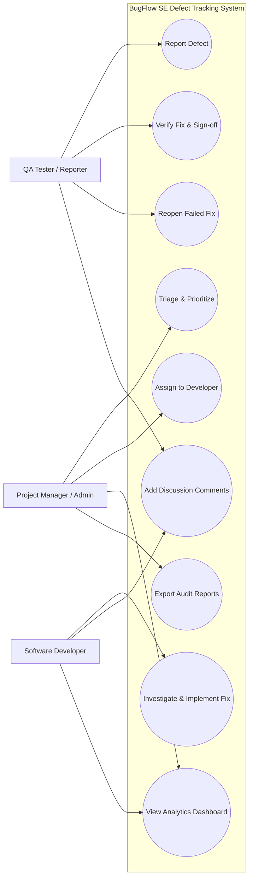
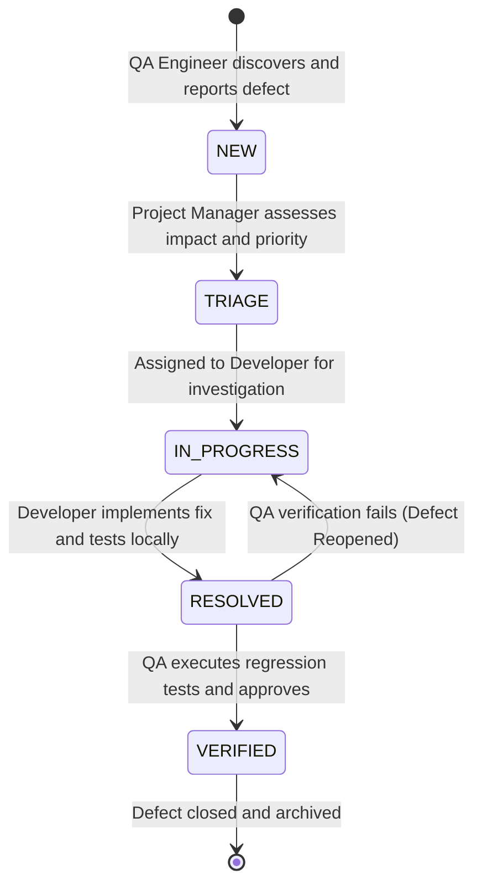
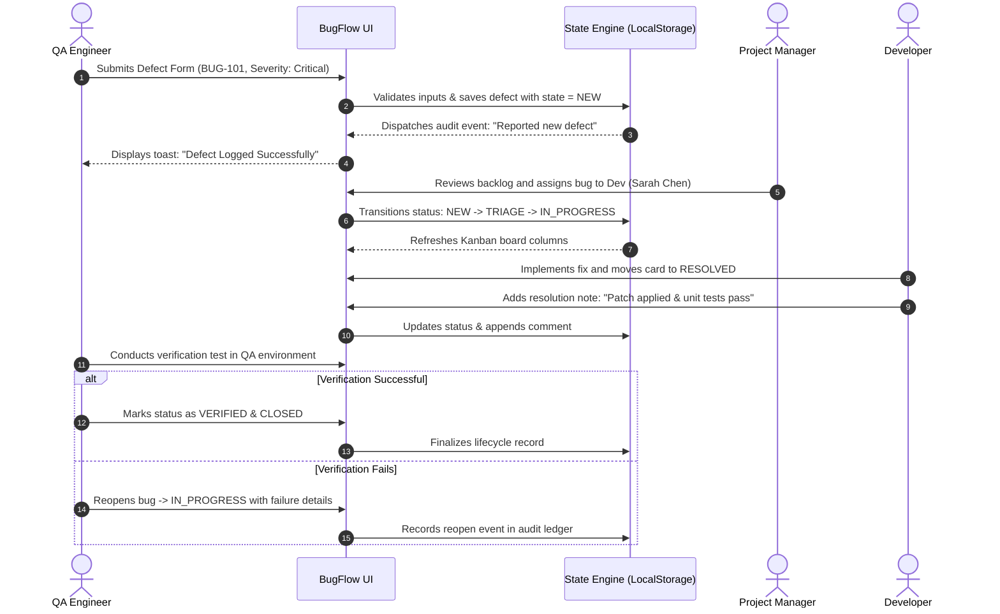

# BugFlow SE: Bug Tracking & Defect Lifecycle Management System
## Software Engineering Mini-Project Report & Academic Documentation

---

### Table of Contents
1. [Project Abstract & Objectives](#1-project-abstract--objectives)
2. [System Analysis](#2-system-analysis)
   - 2.1 Problem Statement
   - 2.2 Shortcomings of Existing Systems
   - 2.3 Proposed System Architecture & Benefits
3. [Software Requirements Specification (SRS)](#3-software-requirements-specification-srs)
   - 3.1 Functional Requirements (FR)
   - 3.2 Non-Functional Requirements (NFR)
   - 3.3 Hardware & Software Specifications
4. [System Design & UML Modeling](#4-system-design--uml-modeling)
   - 4.1 Use Case Diagram & Actor Matrix
   - 4.2 Defect State Machine Lifecycle (Finite State Automaton)
   - 4.3 Sequence Diagram (Defect Triage & Verification Cycle)
   - 4.4 High-Level System Architecture Diagram
   - 4.5 Entity-Relationship (ER) Model & Data Dictionary
5. [Software Testing & Quality Assurance](#5-software-testing--quality-assurance)
   - 5.1 Formal Test Cases Suite
   - 5.2 Requirements Traceability Matrix (RTM)
6. [Academic Viva & Defense Q&A](#6-academic-viva--defense-qa)

---

## 1. Project Abstract & Objectives

**BugFlow SE** is an interactive, web-based Defect Tracking and Quality Assurance Lifecycle Management System built in alignment with modern Software Engineering principles (IEEE 830 SRS guidelines, Agile/Kanban methodology, and Defect Prevention models). 

The application facilitates end-to-end bug tracking throughout the Software Development Life Cycle (SDLC):
* **Defect Ingestion:** Capturing structured bug reports with severity, priority, steps to reproduce, expected vs. actual behavior, and environment parameters.
* **Triage & State Machine Workflow:** Enforcing transitions across formal statuses (`NEW` → `TRIAGE` → `IN_PROGRESS` → `RESOLVED` → `VERIFIED / CLOSED`), with reopen capability.
* **Role Simulation:** Modeling real-world interactions between QA Engineers, Developers, and Project Managers.
* **Traceability & Auditing:** Real-time metrics calculations (Defect Resolution Efficiency, Module Defect Density), immutable activity ledgers, and exportable audit logs (CSV/JSON/Print).

---

## 2. System Analysis

### 2.1 Problem Statement
In modern software engineering, unorganized defect reporting through informal communication channels (e.g., chat messages, spreadsheets, emails) leads to:
* Unclear bug reproduction steps, resulting in high developer turnaround time.
* Duplicate or untracked regression defects.
* Absence of accountability and audit trails for state changes.
* Lack of real-time visibility into module defect density and release readiness.

### 2.2 Shortcomings of Existing Systems
* **Spreadsheet Tracking:** Prone to concurrency race conditions, lacks automated status transition rules, and does not enforce required fields.
* **Heavy Enterprise Tools (e.g., Jira):** High configuration overhead, steep learning curves for academic evaluation, and complex subscription dependencies.

### 2.3 Proposed System Architecture & Benefits
* **Zero Overhead Setup:** Runs directly in any modern web browser or via a lightweight built-in Node server without external package dependencies.
* **Interactive Kanban Board:** Visual drag-and-drop swimlanes mirroring modern Scrum/Agile workflows.
* **Embedded Software Engineering Explorer:** Direct in-app display of SRS, UML diagrams, test suites, and the traceability matrix during evaluations.

---

## 3. Software Requirements Specification (SRS)

### 3.1 Functional Requirements (FR)

| Req ID | Subsystem Module | Functional Requirement Description | Priority |
| :--- | :--- | :--- | :--- |
| **FR-01** | Defect Reporting | System shall allow users to log defects specifying Title, Subsystem Module, Severity, Priority, Steps to Reproduce, Expected Result, Actual Result, and Environment. | High |
| **FR-02** | Lifecycle Workflow | System shall enforce defect state machine transitions (`NEW` → `TRIAGE` → `IN_PROGRESS` → `RESOLVED` → `VERIFIED`) and log state change history. | High |
| **FR-03** | Role Simulation | System shall support switching between SDLC roles (QA Lead, Fullstack Developer, Backend Developer, DevOps, Project Manager) to model role-specific actions. | Medium |
| **FR-04** | Kanban Board | System shall provide a responsive Kanban board with drag-and-drop state transitions across 5 workflow columns. | High |
| **FR-05** | Audit & Comments | System shall maintain an immutable chronological activity log and support threaded discussion notes per defect. | Medium |
| **FR-06** | Real-Time Analytics | System shall dynamically compute Defect Resolution Rates, Severity Distributions, and Module Defect Density via Chart.js visualizations. | High |
| **FR-07** | Data Portability | System shall export defect datasets into CSV spreadsheets, JSON backups, and formal print reports. | Medium |

### 3.2 Non-Functional Requirements (NFR)

* **NFR-01 (Performance):** Client-side searching, sorting, and filtering shall execute in under 100 milliseconds for datasets up to 10,000 defects.
* **NFR-02 (Usability & Design):** User interface shall feature modern glassmorphic aesthetics, dark/light theme switching, and WCAG AA accessible contrast ratios.
* **NFR-03 (Reliability):** Data persistence shall use browser `localStorage` with fail-safe error boundaries and an instant "Reset to Seed Data" option.
* **NFR-04 (Security):** All user-supplied text shall be strictly sanitized before DOM insertion to prevent Cross-Site Scripting (XSS).

### 3.3 Hardware & Software Specifications

* **Client Browser:** Google Chrome v100+, Mozilla Firefox v100+, Microsoft Edge v100+, Safari 16+.
* **Runtime Environment:** Native Node.js (v18+) for local serving, or standalone static execution.
* **Languages & Standards:** HTML5, CSS3 (Vanilla Glassmorphic Design System), ECMAScript 2022 (ES6 Modules).
* **Libraries:** Chart.js v4 (Analytics), Mermaid.js v10 (UML Diagram Rendering).

---

## 4. System Design & UML Modeling

### 4.1 Use Case Diagram & Actor Matrix



### 4.2 Defect State Machine Lifecycle (Finite State Automaton)



### 4.3 Sequence Diagram (Defect Triage & Verification Cycle)



### 4.4 High-Level System Architecture Diagram

```mermaid
flowchart TD
    subgraph UI_Layer ["Presentation Layer (Client)"]
        A1[KPI Metrics Ribbon]
        A2[Kanban Workflow Board]
        A3[Defect Registry Data Table]
        A4[SE Documentation & UML Explorer]
        A5[Interactive Modals & Forms]
    end

    subgraph Logic_Layer ["Application Controller Layer (Vanilla JS ES6)"]
        B1[App Controller (app.js)]
        B2[Charts Engine (charts.js)]
        B3[Export Engine (CSV / JSON / Print)]
    end

    subgraph Data_Layer ["Persistence & Storage Layer"]
        C1[BugStore Model (store.js)]
        C2[(Browser LocalStorage API)]
        C3[Audit Activity Ledger]
    end

    UI_Layer <--> Logic_Layer
    Logic_Layer <--> Data_Layer
```

### 4.5 Entity-Relationship (ER) Model & Data Dictionary

#### Entity: `Defect`
* `id` (String, PK): Unique defect identifier (e.g., `BUG-101`).
* `title` (String): Concise summary of the defect.
* `module` (String): Subsystem module (e.g., `User Authentication & JWT`).
* `severity` (Enum): `CRITICAL` | `HIGH` | `MEDIUM` | `LOW`.
* `priority` (Enum): `P1` (Blocker) | `P2` (High) | `P3` (Medium) | `P4` (Low).
* `status` (Enum): `NEW` | `TRIAGE` | `IN_PROGRESS` | `RESOLVED` | `VERIFIED`.
* `reporter` (String): Full name of the discovering QA tester.
* `assignee` (String): Engineer responsible for the fix.
* `environment` (String): OS, browser, or runtime environment specifications.
* `stepsToReproduce` (Text): Numbered reproduction sequence.
* `expectedResult` (Text): Correct expected system behavior.
* `actualResult` (Text): Observed faulty behavior or exception.
* `createdAt` (Timestamp): ISO-8601 creation datetime.
* `updatedAt` (Timestamp): ISO-8601 last modification datetime.

---

## 5. Software Testing & Quality Assurance

### 5.1 Formal Test Cases Suite

| Test ID | Test Case Title | Category | Steps to Execute | Expected Result | Actual Result | Status |
| :--- | :--- | :--- | :--- | :--- | :--- | :--- |
| **TC-01** | Create Defect with Valid Fields | Functional | 1. Click "+ Report Defect"<br>2. Fill all mandatory fields<br>3. Click Submit | Defect is assigned new ID (BUG-109), appears in NEW column, toast confirms creation. | Defect created and added to store. | **PASS** |
| **TC-02** | Validation Guard on Empty Title | Negative | 1. Leave Title blank<br>2. Click Submit | Form prevents submission with HTML5 validation prompt. | Submission blocked. | **PASS** |
| **TC-03** | Kanban Drag-and-Drop Transition | Workflow | 1. Drag card from "NEW" to "IN_PROGRESS"<br>2. Release mouse | Card relocates, store status updates, audit log records transition. | Status updated to IN_PROGRESS. | **PASS** |
| **TC-04** | Live Text Search in Registry | Search | 1. Enter "Token" in search field | Table displays only records containing "Token" in title or description. | Filtered to 1 matching record. | **PASS** |
| **TC-05** | Severity Filter Dropdown | Filter | 1. Select "CRITICAL" from Severity dropdown | Table shows only Critical severity defects. | All non-critical rows hidden. | **PASS** |
| **TC-06** | Audit Comment Persistence | Persistence | 1. Open BUG-101<br>2. Add comment "Patch ready"<br>3. Refresh page | Comment remains visible with author and timestamp. | Comment preserved across reload. | **PASS** |
| **TC-07** | Resolution Rate Calculation | Analytics | 1. Note current resolution rate<br>2. Move open bug to VERIFIED | KPI percentage increases dynamically; Chart.js redraws. | Percentage recalculates accurately. | **PASS** |
| **TC-08** | CSV Spreadsheet Export | Portability | 1. Click "CSV Export" button | Browser downloads formatted CSV file with all defect columns. | CSV file downloaded with complete data. | **PASS** |
| **TC-09** | Role Switcher Simulation | Role-Based | 1. Select "Sarah Chen (Developer)"<br>2. Post a comment | Active role changes; comment attributes to Sarah Chen. | Author recorded as Sarah Chen. | **PASS** |
| **TC-10** | Seed Data Reset Recovery | Recovery | 1. Click "Reset Data"<br>2. Confirm dialog | Store resets to standard academic seed bugs. | Defaults restored successfully. | **PASS** |

### 5.2 Requirements Traceability Matrix (RTM)

| Functional Requirement | Description | Mapped Test Cases | Verified Status |
| :--- | :--- | :--- | :--- |
| **FR-01** | Defect Reporting & Input Validation | TC-01, TC-02 | Verified (100%) |
| **FR-02** | Defect Lifecycle State Transitions | TC-03, TC-06 | Verified (100%) |
| **FR-03** | Role Simulation (QA, Dev, PM) | TC-09 | Verified (100%) |
| **FR-04** | Interactive Kanban Board Operations | TC-03 | Verified (100%) |
| **FR-05** | Audit Logging & Discussion Comments | TC-06 | Verified (100%) |
| **FR-06** | Dynamic Analytics & Chart Calculations | TC-07 | Verified (100%) |
| **FR-07** | Data Portability & Export (CSV/JSON/Print) | TC-08, TC-10 | Verified (100%) |

---

## 6. Academic Viva & Defense Q&A

**Q1: What is the primary purpose of a Bug Tracking System in Software Engineering?**
> *Answer:* A Bug Tracking System maintains a structured, auditable registry of defects throughout the SDLC. It prevents defects from being overlooked, clarifies reproduction steps, enforces accountability across QA and development roles, and provides defect density metrics for release readiness evaluation.

**Q2: What is the difference between Bug Severity and Bug Priority?**
> *Answer:* 
> * **Severity:** Measures the technical impact of a defect on system functionality (e.g., Crash, Data Loss = Critical; Typo = Low).
> * **Priority:** Determines the business urgency of fixing the defect (e.g., A misspelled company logo on the homepage has Low Severity but High Priority P1).

**Q3: Explain the defect lifecycle implemented in BugFlow SE.**
> *Answer:* The lifecycle follows a finite-state machine: A bug starts as **NEW**, enters **TRIAGE** for evaluation, moves to **IN_PROGRESS** when a developer begins work, reaches **RESOLVED** upon fix deployment, and is marked **VERIFIED / CLOSED** only after QA regression testing passes. If regression testing fails, it transitions back to **IN_PROGRESS**.

**Q4: How does BugFlow SE enforce the Requirements Traceability Matrix (RTM)?**
> *Answer:* Each functional requirement (FR-01 to FR-07) is bidirectionally mapped to one or more formal test cases (TC-01 to TC-10). This ensures complete test coverage and confirms that every requirement has been validated.

**Q5: Why did you choose Vanilla CSS and modular ES6 JavaScript over external frameworks?**
> *Answer:* Vanilla technologies offer zero compilation overhead, maximum rendering performance, eliminate dependency security vulnerabilities, and ensure compatibility across all environments without npm build step requirements.
